# Using РЭХА

This guide follows a rehearsal from start to finish: setting up, recording
takes, listening back and sharing the good ones. A take is one recording:
you start it, the band plays, you stop it. The last sections cover what to
do when something goes wrong, and where your recordings are kept.

## Before you play

### Choose your interface

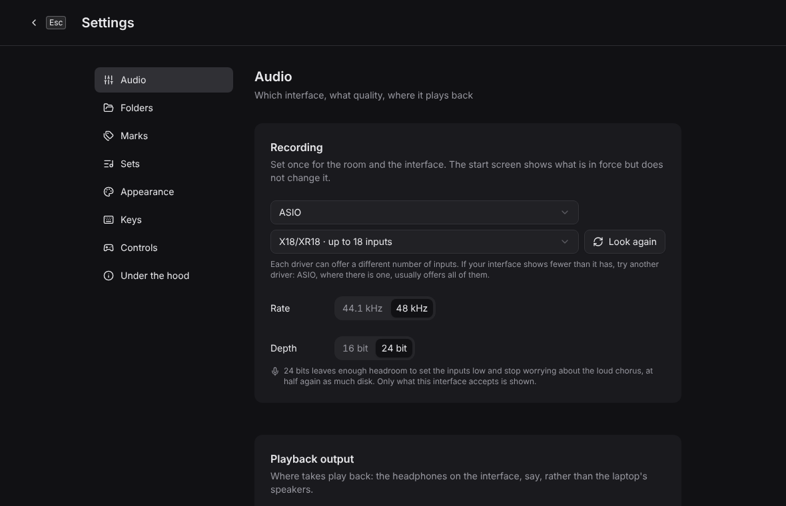

Open **Settings** (the gear at the top right of the start screen). Under
**Audio**, choose your audio interface: the box or mixer that the
microphones and instruments plug into, connected to the computer. You
usually do this once for the room, not before every rehearsal.

On Windows you choose a driver first, then the interface. The driver is the
way Windows talks to the interface. Choose **ASIO** if your interface has an
ASIO driver: it usually gives you all the inputs, while the other drivers
often show only two. If there is no ASIO driver, choose **Windows WASAPI**.

Then choose the **Rate** and **Depth**, the recording quality. Only the
combinations your interface accepts are offered. See [Recording
quality](#recording-quality) if you are not sure which to pick.

Under **Playback output**, choose where takes are played back, for example
the headphone outputs of your interface instead of the laptop speakers. Each
device shows how many outputs it has. Under **Outputs**, choose which of them
to use: a pair such as 3–4, or one output on its own. On Windows a driver
other than ASIO often shows an interface with only two outputs; choose it
under **ASIO** to get all of them. **System output**, the one the
computer's own sound settings choose, always plays through 1–2.

### Set up the tracks

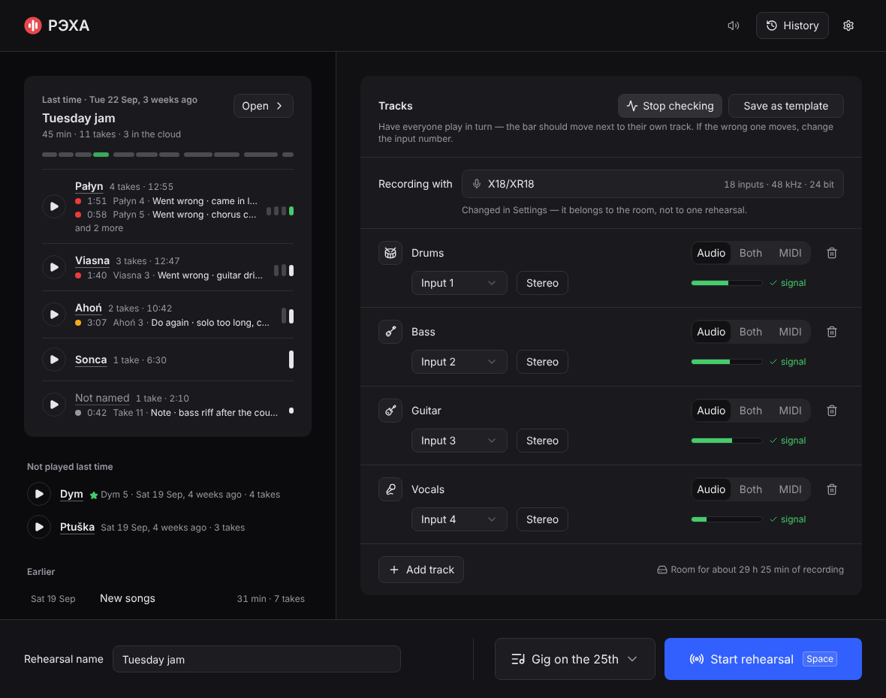

The start screen, the one the app opens on, has one track per musician. A
track is one musician's part of each take. It is recorded from an input: the
numbered socket on the interface that their microphone or instrument plugs
into. Beside **Recording with** is the interface, with how many inputs it
has and the recording quality. Click it to open Settings.

- Type a name for the rehearsal in **Rehearsal name**, at the bottom beside
  the set and **Start rehearsal**, or keep the one with today's date. For
  sets, see [Play by a set](#play-by-a-set).
- Name the tracks and choose each one's input.
- The icon at the start of a row says what the track is. Click it and
  choose one: vocals, electric or acoustic guitar, bass, drums, keys and
  more. It is shown on the recording screen and in the player. A new track
  has a plain one until you choose.
- **Add track** adds a musician, and the bin icon removes one. A notice says
  which track was taken off, and for 10 seconds **Undo**, or ⌘Z on a Mac
  (Ctrl+Z elsewhere), puts it back in its place.
- **Stereo** records an input and the next one together as one stereo track,
  for a keyboard or a pair of overhead microphones. See
  [Stereo instruments](#stereo-instruments).
- **Audio**, **Both** and **MIDI**, at the top right of each track, say what
  the track records: its input, its input and a MIDI port, or a MIDI port
  alone, for an electronic kit or a keyboard. See [Recording
  MIDI](#recording-midi).

The tracks, their icons and their inputs are remembered when you start the
rehearsal, and the start screen opens with them next time.

### Lineups

A lineup is the band's tracks kept under a name: who plays, their icons,
and the input each of them uses on each interface. A band often needs more
than one, for the week the drummer cannot make it or the night a friend
brings a keyboard. The tracks you had before lineups came in are the first
one, called “Band”.

The title over the tracks is the lineup on screen, for example **Full
band**. Click it to choose another one: its tracks take the place of the
ones on screen at once, each on its own input. The same menu has **Save as
new lineup…**, and **Rename** and **Delete** for the lineup on screen.
Delete asks first, and the tracks on screen stay.

Take a track off or change an input, and the title says “Full band ·
changed”. Two buttons then stand beside **Check signal**:

- **Update** keeps the change in the lineup.
- **Save as new…** asks for a name and keeps the tracks on screen as
  another lineup.

For one evening you need neither. Say the drummer is away: take the drums
off and start the rehearsal. Next time the start screen opens the same way,
as “Full band · changed”. When the drummer is back, choose **Full band**
and all four are there, the drums on their own input. If the bass player
has gone stereo for good, make that change once and press **Update**.

Choosing a lineup when the tracks on screen are changed puts the lineup's
tracks up all the same. A notice says “Your changes to Full band were not
kept.”, and for 10 seconds **Undo** brings them back.

A take keeps the icons it was recorded with, whichever lineup you choose
later.

### Check the signal

Press **Check signal** and have everyone play in turn. The bar next to each
track should move when that person plays. If the wrong bar moves, change the
input of that track. A track shows **signal** once sound has arrived on it;
a stereo track needs sound on both sides. **Stop checking**, the same
button, ends the check.

The free disk space is shown under the tracks, as recording time: “Room for
about 29 h 25 min of recording”. It takes the number of tracks and the
recording quality into account. When the disk is nearly full, the line
gets an amber icon and says so: “Low disk space: room for about 12 min”.

### Last time

Left of the tracks is the rehearsal before this one, song by song: how many
takes each song got and how long they ran, with the marks you left while
listening. A mark flags one moment in a take, with a label such as *Went
wrong* and a comment if you like (see [Marks and their
labels](#marks-and-their-labels)). In a window narrower than 1100 px (wider
at a larger **Scale** in **Settings › Appearance**) it is behind the **Last
time** button at the top of the window, which opens it from the left and
shows when something from it plays.

▶ on a song plays its newest starred take (★, see [Starring a
take](#starring-a-take)), wherever you played it, and says which and when if
it is not last time's last take. A song with no star plays its last take,
which is usually the one you settled on. Listen to where you left off before
you start.

Under it, **Earlier** lists the rehearsals before that. **Open**, or a
rehearsal under **Earlier**, opens it in History. A soundcheck with no named
takes is skipped: last time is the last rehearsal that played a song.

While something plays from here, Space pauses it and Esc stops it. Once it
has stopped, Space starts the rehearsal as usual. **Check signal** stops it
too.

### Play by a set

A band getting ready for a gig plays the same songs in the same order,
rehearsal after rehearsal. A set is those songs, in that order, with a name:
“Gig on the 25th”. The rehearsal screen then lists them under the next
take's name, and History says afterwards which of them were played.

The button left of **Start rehearsal** says which set the rehearsal will
play by, or **No set**. Click it to choose another set, **No set: play
freely** to play without one, or **New set…** to make one without leaving
the screen: a name, then the songs in the order you play them. Drag a song
by its handle to move it, and ✕ takes it out. Under them are the songs you
have played, to add with a click, and **Another song…**, a field for one
nobody has played yet, such as a new song for the gig. **Create set** makes
the set and picks it. The set stays picked for the rehearsals after this
one, until you pick another.

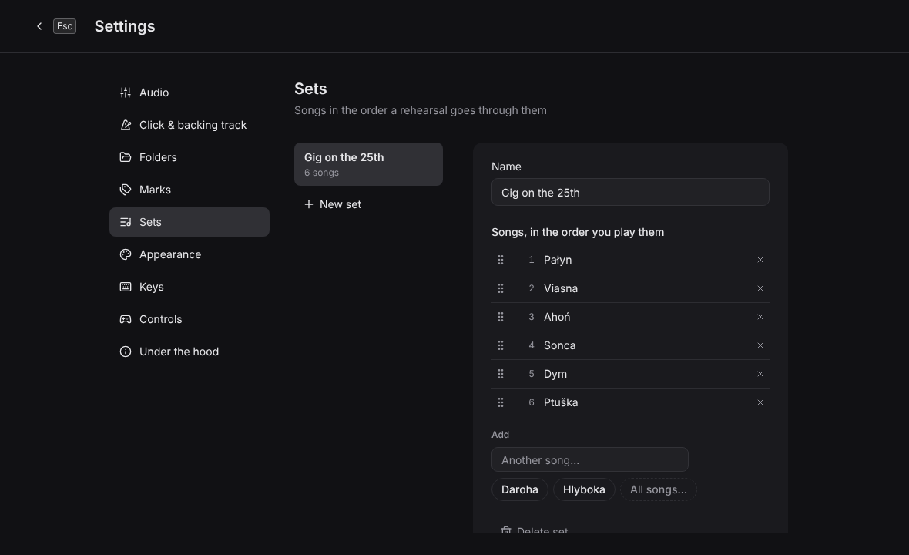

**Settings › Sets** has all your sets down the left. Click one to change its
name or its songs, beside the list; changes are saved as you go. **Delete
set** deletes it, after asking. A rehearsal already played by it keeps its
takes and their names, and History still shows the set as it was at that
rehearsal. **New set** under the list makes another. ✕ beside a song in the
set takes it out at once. For 10 seconds, **Undo** in the notice that says
so, or ⌘Z on a Mac (Ctrl+Z elsewhere), puts it back where it was.

## Recording takes

### The rehearsal screen

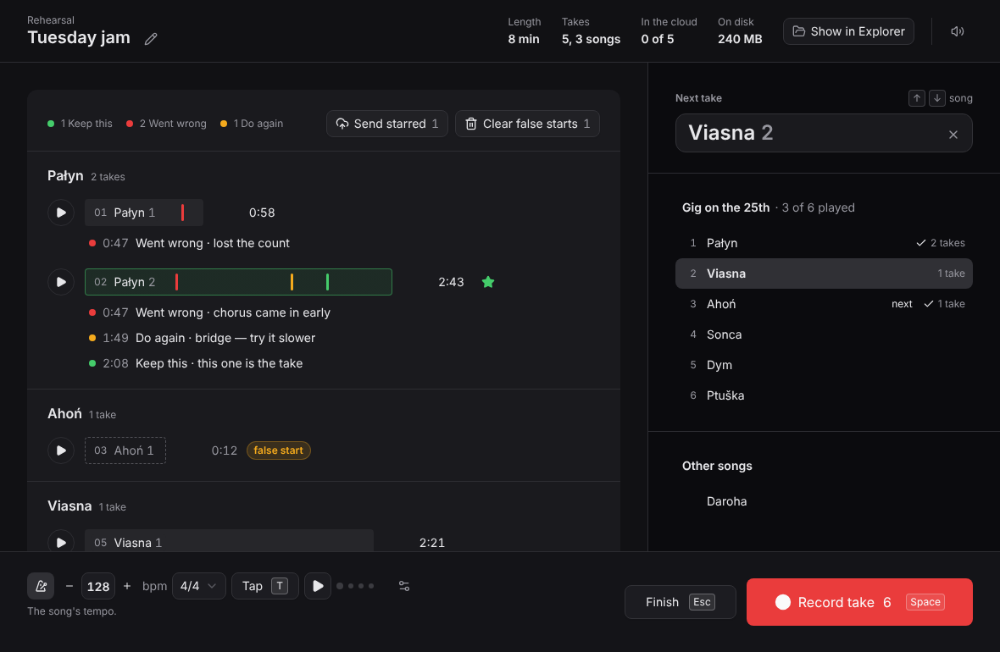

Press **Start rehearsal**, or Space. The rehearsal screen shows the takes
recorded so far, grouped by song. Each take is a bar drawn to its length,
with its marks on it and listed under it, so a take that ran long or
stopped short stands out before you read anything.

- **▶** at the start of a row plays the take right there. Space pauses and
  continues it, and Esc stops it.
- Click anywhere on a take's row, the bar or past it, to open the take in
  the player (see [Listening back](#listening-back)). If it is playing, it
  goes on playing from the same place.
- Click a mark under a take to open the take at that spot.
- Point at a row to star the take (★, see [Starring a
  take](#starring-a-take)), rename it, send it to your cloud folder (see
  [Sending takes to the cloud](#sending-takes-to-the-cloud)) or delete it.
  The ★ stays in view on a starred take.

You can sort out the rehearsal here as it goes, while everyone still
remembers which take was the good one. None of this has to be done:

- Under a take nobody named, **Name:** lists the songs, the same ones as
  under **Next take**. Click one to name the take after that song: it
  becomes the song's next take and moves into the song's group. For a song
  nobody has played yet, use the pencil.
- A take shorter than 30 seconds, with no ★ and no marks, is a false
  start, such as a stop after eight bars, or a take that holds only the
  count-in (the beats counted before the band comes in). Its bar is
  dashed, its name and length are grey, and it says **false start**.
  **Clear false starts**, at the head of the songs, moves them all to the
  Trash (the Recycle Bin on Windows) at once, and their copies in the cloud
  go with them; **Undo** brings them back. See [Undo](#undo). How short a
  false start is can be changed in **Settings › Folders**, from 5 to 120
  seconds.
- **Send starred**, beside it, sends every ★ take that is not in the
  cloud folder yet, as **What gets sent** in **Settings › Folders** says.
  See [Sending takes to the cloud](#sending-takes-to-the-cloud).

The two buttons sit at the head of the songs, beside the rehearsal's marks
counted by label, each in its colour: “2 Keep this”, “1 Went wrong”. Each
button shows how many takes it would act on. With none it is greyed, and
pointing at it says why.

Press **Record take**, or Space, to start recording. **Finish** ends the
rehearsal and goes back to the start screen, where Last time shows the
rehearsal just finished. Closing the app instead loses nothing: every take
you saved is kept. The row at the bottom left, beside **Finish**, is the
metronome: see [The metronome](#the-metronome).

The top of the window has the rehearsal's name and its figures so far:
**Length**, how long its takes run; **Takes**, how many there are and of
how many songs; **In the cloud**; and **On disk**, how much of the disk the
rehearsal uses. **Show in Finder** (**Show in Explorer** on Windows) opens
its folder. A long name wraps, with its pencil after its last word, and is
never cut. When the name needs the room, the figures go one whole figure at
a time: the size on disk first, then the cloud, then the takes, and the
length last. Once one has gone, pointing at them shows them all. The button
always stays. The player in History has the same figures and button beside
the rehearsal's name, which wraps there too, but no pencil.

On the right is **Next take**: the name the next take will get, in a field
of its own, and under it the songs. A long name wraps in the field. A new
take is of the same song as the one before it, so the name stays until you
move on to another song.

When you play by a set, the set comes first in the panel, under the field:
“Gig on the 25th · 3 of 6 played”, then its songs in order. The song in the
field is lit, and the one after it says **next**. A song played tonight has
✓ and how many takes it got. The rehearsal's first take is the set's first
song. A set with no songs in it yet says so, and that they are added in
**Settings › Sets**. Under the set, **Other songs** are the songs outside
it. With no set the list is called **Songs** and has every song you have
played: tonight's first, then the songs of earlier rehearsals, the latest
first. Five show, and **All 18 songs** (with your own count) under them
opens the rest; the song in the field shows even when it is not among the
five.

To move on to another song:

- Click its row. The set's rows never move, so going back to a song is one
  click too.
- Or press ↓ or ↑ for the row below or above the lit one: the set's songs,
  then the other songs. The two keys at the right of **Next take** say so.
  While a take is open in the player, the arrows work the player instead.
- Or click the field, which selects the name, and type: the songs narrow to
  the ones that match, and ↓ or ↑ then Enter picks one. A name no song has
  is a new song, and Enter keeps it.

The take is then recorded under that name, and the recording screen can say
how long the last take of that song took. ✕ in the field puts back the name
the take would have had anyway. If you discard the take, the next one keeps
the name you picked.

### While recording

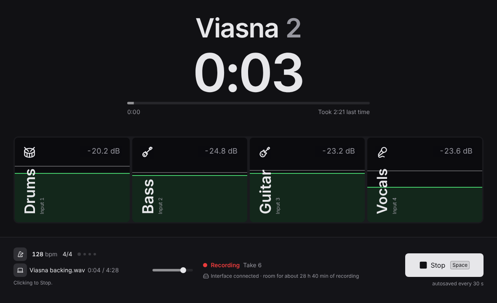

The recording screen is big enough to read from where you play.

- The take's name is over the clock, half its size, so you can see from
  where you stand what you are recording. If it says “Take 3”, nobody named
  the take: name it after **Stop**. A take you named has its place in the
  rehearsal, “Take 6”, at the bottom beside **Stop**, after the red
  *Recording*.
- The clock shows how long the take has been running. A take recorded to
  the metronome's click counts the band in first, in big digits in the
  clock's place, and the clock starts when the count-in ends (see
  [Recording to the click](#recording-to-the-click)).
- The bar under the clock appears when this is another take of a song you
  have already played in this rehearsal: “Took 2:21 last time”. The
  rehearsal's first take of a song played before is measured against the
  take ▶ plays for it in Last time: its newest ★ take, or the last take of
  the last rehearsal that played it, “Took 3:20 on 22 Sep”. The bar fills as
  you play, so you can see how far into the song you are.
- Each track has a tile that fills from the bottom with its level. The fill
  is in dB, like the meters on a mixer: −60 dB at the bottom, the loudest
  the input can take at the top. If the gain is set so that the loudest hit
  reaches about −18 dB on the mixer, that hit fills about two thirds of the
  tile. The fill jumps up with each hit and sinks back slowly, as on a
  mixer. The figure at the top is the latest peak, held for a moment so that
  it can be read. The track's icon is in the top left corner. A stereo track
  is split down the middle, left and right.
- A tile that clipped (got more than the input can take, so the sound is
  distorted) turns red and says how many times, “clipped 3×”. It stays red
  until the take ends, so you still see it when you look up if you were
  playing when it happened. A tile with nothing coming in, below −60 dB,
  goes dim and says “silent”, which is normal while someone is not
  playing.

At the bottom beside **Stop**, under the red *Recording*, a line says that
the interface is connected and how much recording time the disk has left:
“Interface connected · room for about 3 h 20 min of recording”. When the
disk is nearly full, the line gets an amber icon and says “Low disk space:
room for about 12 min. Free some up or finish the rehearsal.” It does the
same when the laptop runs on its battery with 20% or less left: “Battery
14%: plug the laptop in”.

While a take records, the laptop does not go to sleep and its screen does
not go dark or lock, whatever the system's own settings say. After Stop,
once the take is written, they apply again.

Every track is written to disk while you play, so there is nothing to save
during a take. Press **Stop**, or Space, when the song is over.

### Keep the take or not

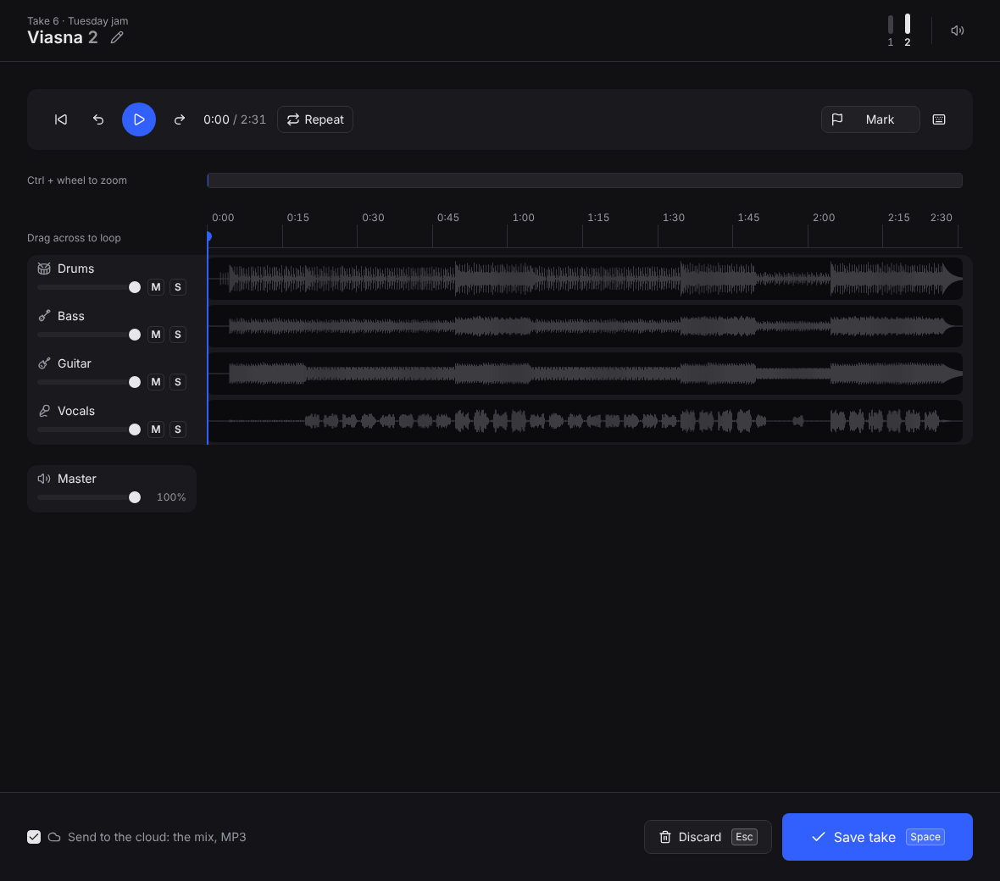

After you stop, the take opens straight away. Listen to it, then press
**Save take** (Space) to keep it or **Discard** (Esc) to throw it away. A
discarded take goes to the Trash at once. **Undo**, or ⌘Z on a Mac (Ctrl+Z
elsewhere), brings it back to this screen as you left it, with its name,
its marks and whether it goes to the cloud. See [Undo](#undo). If the take
cannot be saved, a red notice says why and stays until you close it. The
take is still here, so press **Save take** again.

The take's name is at the top: the song and its number, “Viasna 2”. A long
name takes a second line, and one longer than that is cut with its number
kept; point at it to read it whole. The small line over it gives the take's
place in the rehearsal and the rehearsal's name, “Take 5 · Thursday”; a long
rehearsal name is cut, and shows whole when you point at it. A take nobody
named says “Take 7”, in grey. How long the take ran is in the player,
“0:00 / 2:31”.

At the right of the name are the song's takes tonight as columns, the last
ten of them. Each is as tall as that take ran, with the take's number under
it. This take's column is in the colour of the text, the starred takes (★)
are pale green and the others grey. Point at the columns to read them as
times: “Viasna 1: 2:31, Viasna 2: 2:41”. A song's first take tonight has no
columns, and nor does a take nobody named. In a narrow window the columns go
first, to leave the name its room; point at the name to read them then.

Check the name before you save. It is filled in for you: after a take called
“Pałyn”, the next one is “Pałyn 2”. The pencil right after the name opens
**Rename take**. The songs you have played are listed under its field, this
rehearsal's first, then the others, most recent first: click one, or type a
name, and press Enter. The title and the columns follow. ✕ in the field puts
back the name the take would have had if none had been picked before
recording. While **Rename take** is open, Space types and Esc closes it. See
[Names and songs](#names-and-songs).

The bottom left says whether this take goes to your cloud folder: “Send to
the cloud: the mix, FLAC”, with a box in front. The line names what would be
sent and in which format, as you set them (see [Sending takes to the
cloud](#sending-takes-to-the-cloud)), and the box starts ticked when **Send
saved takes automatically** is on. Tick it to send this take, or untick it
to leave it on this computer; the setting stays as it is. The box lets go of
the keyboard as soon as you change it, so Space still saves the take. With
no cloud folder, the line says “Stays on this computer: no cloud folder is
set”.

You can listen, add marks and crop the take here, before you save it (see
[Listening back](#listening-back)). The marks are saved with the take.

## Listening back

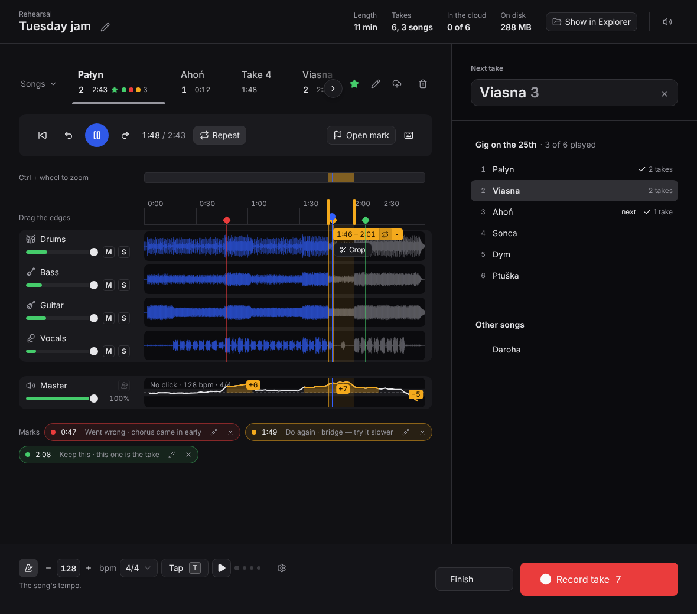

Click a take on the rehearsal screen or in History to open it in the
player. The strip at the top has a tab for each song of the rehearsal, in
the order they were first played, and one for each take with no song. On
the open tab, the song's name has the open take under it. Any other tab
shows the take a click on it opens: the song's last take at that rehearsal.
**Songs** at the start of the strip, or the open take's number, turns each
tab into a column of its takes. Click a take in a column to open it. All a
take's tracks play together on one timeline, so they always stay in sync.

Another take of the same song opens at the same place: the same second, the
same selection, Repeat on or off, the same zoom, and playing if the last
one was. Loop the chorus of one take, then open the next to hear the same
bars. The takes don't line up exactly, but close enough to find a chorus by
ear. ↑ and ↓ go to the previous and next take of the song the same way.
Another song's take opens from its start. Opened from a song's page in
History, the song's column has every take of it from every rehearsal, the
oldest first, under each rehearsal's day, and ↑ and ↓ go on from one
rehearsal into the next.

- Play and pause with the big button or Space. The arrow keys jump 10
  seconds back and forward, and Home goes back to the start. Click anywhere
  on the tracks to jump there.
- Each track shows its icon and name. The tracks are one panel, with no
  lines between them: each track's waveform, the drawing of its sound, sits
  on a darker background of its own. A name too long for its place is cut, and
  shows whole when you point at it or reach it with Tab.
- Balance the band with the fader under each track name. **M**, after the
  fader, mutes a track, and **S**, after **M**, plays it on its own; each is
  grey while it is on. Volumes are remembered by track name, so the next
  take starts with the same balance.
- Turn the whole take up or down with **Master** under the tracks. It only
  changes how loud you hear it. The balance and the copy sent to the cloud
  stay as they are. The app remembers it for the next take. Its meter shows
  the whole mix, and turns red when the tracks together are too loud. The
  speaker at the top of the window is the same control, there on every
  screen a take can be played from, even with no take open.
- To mark a moment, press **Mark**, or the M key, while the take plays.
  Pick the mark's label and type a short comment if you like. The labels are
  one switch: Tab comes to it once, the arrow keys move along it, and Space
  picks the label you are on. A new mark has the first label in the list
  (see [Marks and their labels](#marks-and-their-labels)). A mark is drawn
  in its label's colour on the waveform, and the take's line in the strip
  shows those colours too, so you can see which takes were marked what
  without opening them. Click a mark to jump to it. Near a mark, the button
  says **Open mark** and opens that one.
- To loop a part, drag across the tracks to select it, then turn on
  **Repeat**, next to the time, or the loop button beside the selection's
  times. Drag the edges on the ruler to adjust the selection. The cross
  beside its times removes the selection. It leaves the take as it was.
- To trim a take, select the part worth keeping and press **Crop**, under
  the selection's times. It crops at once: the take as it was goes to the
  Trash, and the marks inside the part move with it. **Undo** puts the
  uncut take back.

A few things about cropping:

- Marks outside the part you keep are removed. **Undo** puts them back
  with the uncut take.
- **Crop** is greyed out when the selection is shorter than a second, or when
  it covers the whole take.
- If the take was already in the cloud folder, its copy there is made again
  from the cropped take, as the mix, the tracks or both, whatever was there
  before. This happens whether automatic sending is on or not.
- Once the notice has gone, the take as it was is in the Trash, as one
  folder named after the take with “(before crop)” after it. To get the
  audio back then, move its files back into the take's folder. The app
  still shows the shorter length, and the marks stay where the crop moved
  them.
- A take recorded to the metronome's click (see [The
  metronome](#the-metronome)) keeps its bars. The crop starts on the bar
  line at or before the start of your selection, and ends in time with the
  click, at most one click after the end of it (two in 6/8), so in a DAW
  the cropped take still starts on a bar. When the start moved back to a
  bar line, the notice says where: *“Pałyn 2” is cropped. It now starts on
  the bar at 0:01. The uncut take went to the Trash.*

Press Esc to close the take. With the strip's columns open, the first Esc
closes them. If the take is playing, it goes on playing in the list of
takes; press Esc again to stop it. While a take is open or playing,
Space plays and pauses it instead of starting a new take.

### Starring a take

A star (★) is for a take worth coming back to: the one you settled on, or
the one where it finally worked. Click the star on a take's row in the list
of takes, where it shows under the mouse, or beside the open take in the
strip. Click it again to take it off. A song can have several starred
takes, and a take with no song can have one too.

A starred take is the green one, in the list of takes and in the
rehearsal's strip in Last time and History, and its line in the player's
strip carries a ★. A mark is about one moment, whatever its label: a *Keep
this* mark does not star its take. ▶ on a song, in Last time or on its page
in History, plays its newest starred take. The star stays with its take
when you rename it or crop it, and goes when you delete it.

### Zooming in

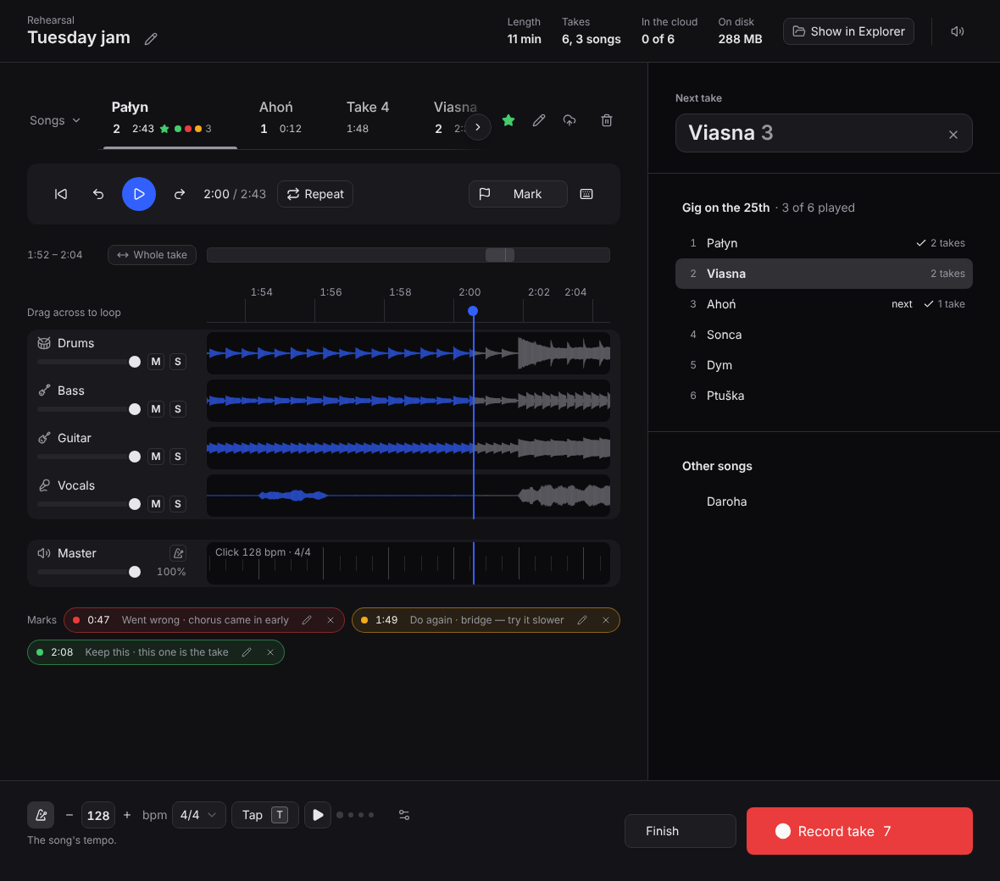

At first the whole take is on screen. To look closer, hold Ctrl (⌘ on a Mac)
and scroll the mouse wheel over the tracks, or pinch on a touchpad. The point
under the mouse stays where it is. The wheel on its own scrolls the page, as
it does everywhere else. To move along the take, swipe sideways with two
fingers on a touchpad, or hold Shift and scroll. The waveform is redrawn for
the part on screen, so you see real detail. At the closest zoom about two
seconds fit on the screen. The keys button at the end of the player's row,
or the ? key, lists all of this with the player's keys.

Above the ruler is a map of the whole take. Zoomed in, the grey stretch on
it is the part on screen, and the orange one is the selection, if there is
one. At the closest zoom the map says “closest zoom”. Drag the grey stretch
to move along the take, or click anywhere else on the map to go there.
Zoomed in, **Whole take**, beside the map, zooms back out. The buttons
beside the selection's times and **Crop** are only on screen with the
selection: zoomed to another part of the take, go back to it on the map or
with **Whole take**.

While a take plays, the view follows the playhead, the line that shows
where it is playing. If you scroll away, it stops following until the
playhead comes back into view.

## Names and songs

Each take belongs to a song. You name it with the song's title, and the app
counts the song's takes: the number beside the name, “Pałyn 1”, “Pałyn 2”,
goes on from one rehearsal to the next, so “Pałyn 17” is one take wherever
it was played. Deleting a take does not free its number. A new take is of
the same song as the one before it, so you only name a take when the band
moves on to another song.

Type the title only; the number is the app's. Typing “Pałyn 5” names the
take Pałyn, at whatever number is next. A song is spelled one way everywhere:
typing “pałyn” gives “Pałyn” when that song is there. A title can end in a
number, like “Opus 5”, as long as no song is called “Opus”. A take nobody
named is called by its number, “Take 4”, and is not counted as a song. The
same goes for a recovered take you did not name (see [The app closed during
a take](#the-app-closed-during-a-take)). On the rehearsal screen and in
History, the songs are listed under such a take, so one click names it.

Wherever you name a take, the songs you have already played are listed, so
you do not have to type them again. On the rehearsal screen they are the
rows under **Next take** (see [The rehearsal screen](#the-rehearsal-screen)).
In **Rename take** they are under the name, and under a take nobody named
they follow **Name:**. There each song shows the number the take would get,
dimmed beside it. **Rename song** lists the titles alone. **All songs…** at
the end lists every song you have ever played, alphabetically. A click puts
only the title in the field. Typing narrows the list to the songs that
match, and clicking one then takes you out of the field, so the next Space
records or saves. In the **Rename take** dialog you stay in the field, and
Enter renames.

Elsewhere a song's title opens the song's page in History: in Last time on
the start screen, and as a song's heading over its takes on a rehearsal's
page in History. **Not named** opens the page of the takes nobody named. The
songs listed under a name field only fill the field.

To rename a take or a rehearsal later, use the pencil button on the rehearsal
screen or in History. The folder on disk is renamed too, and a rehearsal
folder keeps its date: `Tuesday jam - 2026-09-18 19-00`. If you rename a take
that is open in the player, it starts again from the beginning.

To rename a song, use the pencil after its title on its page in History.
Every take is renamed, with its folder on disk and its copies in the cloud
folder; the files follow in the background, and the list of work in the
background says so (see [Following the copies](#following-the-copies)). A
title that differs only in capitals respells the song. Here a number at the
end is part of the title: “Opus 5” is the whole of it. “Take 4” cannot be a
song's title, since it is what a take with no song is called.

The same song typed two ways, “Palyn” one night and “Pałyn” the next, is two
songs until you merge them. Rename song lists the other songs under the
title: click one, or type its title, and **Rename** becomes **Merge…**. The
app asks first, saying how many takes from how many rehearsals are renamed
and what they become. They are numbered after the song's own, in the order
they were played, so Palyn 1 and 2 become Pałyn 8 and 9; stars stay where
they were. A merge is not undone in one step: to split a song again, rename
its takes one by one.

A title a song leaves behind, renamed or merged away, is remembered: typed
again in any name field, with or without a number, it is that song. The
field says “Palyn → Pałyn 12”, and under it, “Palyn is Pałyn now. Make
Palyn a new song”. The link forgets the old name at once, with no
**Undo**, and the take is a new song, Palyn 1.

A song's page lists its old names under the title, **Also typed as** Palyn,
each with × to forget it. A notice then says *“Palyn” was forgotten.*, and
its **Undo** gives the name back to the song. If Undo cannot, because the
name is another song's by then, the notice says why.

## History

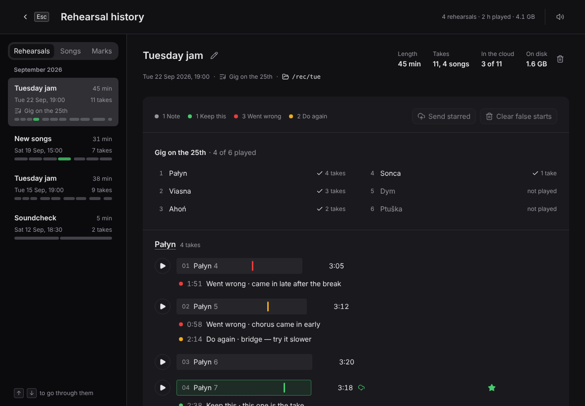

**History** has three views, switched at the top of its list: **Rehearsals**,
one by one, **Songs**, song by song, and **Marks**, label by label.
It opens on the one you used last, or on the rehearsal or song you opened
from the start screen. The switch stays in view while the list scrolls.

**Rehearsals** lists your past rehearsals down the left, by month, and shows
the chosen one beside the list. It opens on the newest. Each rehearsal in the
list shows when it was, how long you played and how many takes there are,
with the rehearsal drawn as a strip: a bar for each take, as long as the
take, grouped by song, and green for a starred take. You can see at a glance
how many songs you played and how many takes each one got.

At the top of the window, beside the title, are how many rehearsals there
are, how long you played in all and how much of the disk they use:
“5 rehearsals · 2 h 24 min played · 5.0 GB”. In a narrow window they give
way one at a time, the size first, and pointing at them then shows them all.

Click a rehearsal to show it, or go through them with ↑ and ↓. Its takes
work the same way as on the rehearsal screen: **▶** on a take plays it
right there, and the take's bar opens it in the player, which then has the
whole window. Esc brings the list back. You can sort out a rehearsal here
the same way too: the songs under a take nobody named, the false starts,
**Send starred** and **Clear false starts**. A take that cannot be loaded
shows a red warning sign in place of its ▶, here, on a song's page and in
Marks; press it to try again.

The rehearsal's name is at the top of its page, with the pencil after its
last word (**Rename rehearsal**) and the bin at the right (**Delete
rehearsal**). A long name takes two lines, here and in the list, and is then
cut: point at it to read it whole. Beside the name are the rehearsal's
figures, as at the top of the rehearsal screen: how long its takes run, how
many takes there are and of how many songs, how many are in the cloud and
how much of the disk it uses. They give way before the name takes a second
line, the size on disk first, and once one has gone, pointing at them shows
them all.

Under the name are the day it was played, its set if it was played by one,
and the path of its folder: where the folder is on your computer, written
out, such as `C:\Users\alex\RehearsalRecordings\Tuesday jam - 2026-09-18 19-00`.
Click the path to open the folder; pointing at it says **Show in Finder**
(**Show in Explorer** on Windows). A long path is cut at its end, and
pointing at it shows it whole.

A rehearsal played by a set has the set's name under its date in the list,
and beside the date on its page. Over its songs, a card says how much of the
set was played, “Gig on the 25th · 4 of 6 played”, and lists the set's songs
in order, in two columns when there is room: each one played with ✓ and its
takes, each other **not played**. Click a played song to go to its takes.
The card shows the set as it was at that rehearsal, whatever has changed in
it since.

You can rename and delete takes and whole rehearsals here. Deleting moves
the take or the rehearsal's folder to the Trash at once; **Undo** brings it
back. See [Undo](#undo).

If a rehearsal's folder was moved or renamed outside the app, or is on a
drive that is not plugged in, the rehearsal is marked **Not found on disk**
in red, in the list and on its page, and its path can no longer be clicked.
**Locate folder…** lets you show the app where the folder is now.
**Remove from history** takes it off the list without touching any files.

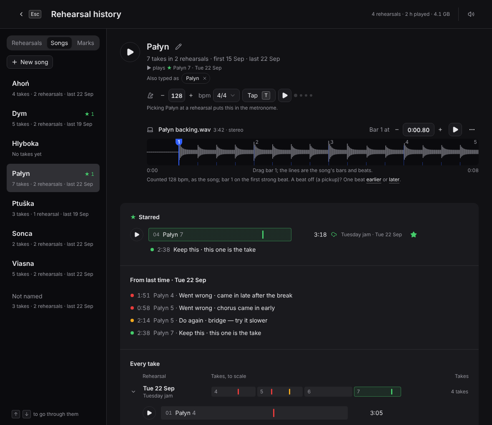

**Songs** lists every song you have played, alphabetically, with how many
takes and rehearsals it had, when it was last played and how many of its takes
are starred. The takes nobody named come last, as **Not named**. Click a
song, or go through them with ↑ and ↓.

A song's page starts with a big **▶**, which plays its newest ★ take, or its
last take when none is starred. The pencil after the title (**Rename song**)
renames the song, or merges it into another (see [Names and
songs](#names-and-songs)); what is playing stops first. A long title takes
two lines and is then cut, as a rehearsal's name is. **Starred** comes
next, with its ★ takes, then **From last time**, the marks left on it the
last time it was played; a mark opens its take at that spot. Then **Every
take** has every take of the song, one line per rehearsal, newest first: the
rehearsal's day and name, and its takes as bars side by side, all drawn to
the song's longest take. When a rehearsal has more takes than fit
on its line, they carry on to a second line. A take that ran long or stopped
short shows without reading a number; a ★ take is green, and a mark is a
tick in its label's colour.

Click a line to open it to its takes, and again to close it. The newest
rehearsal is open to begin with, and the lines you open stay open while
History is. You can play, open, star, rename or delete the takes in an open
line as anywhere else, and **Open … in Rehearsals** under them shows the
whole rehearsal. Esc from the player comes back to the song, scrolled where
you were.

A rehearsal whose folder is not on disk stays on a song's page, marked
**Not found on disk** in red, and its bars have a dashed edge. Its takes
are counted, but they cannot be played or opened until the drive is back.

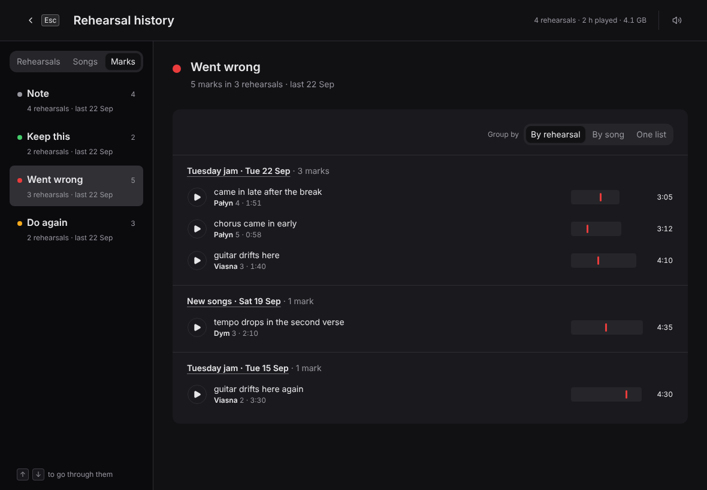

**Marks** lists your labels down the left, in the order **Settings › Marks**
has them, each with how many marks have it, in how many rehearsals, and when
the newest was left. A label nothing has yet is dimmed. Click a label, or go
through them with ↑ and ↓.

Beside the list are the label's marks, from every rehearsal, newest first.
**Group by**, at the top right of them, puts them under a heading per
rehearsal (**By rehearsal**), per song (**By song**, the takes nobody named
last), or in **One list**. The choice is kept, and is the same for every
label. A heading says how many marks are under it, and opens its rehearsal
in Rehearsals, or its song's page.

Each mark is a row: its comment, or the label's name when it has none, then
the take and the moment, *Pałyn 4 · 1:51*. Then the take as a bar, drawn to
the longest take in the list, with the mark as a tick in the label's colour.

- **▶** plays the take right there, from 5 seconds before the mark, so you
  hear the moment coming. Press it again to pause.
- Clicking the row opens the take in the player at the mark. So does Enter
  on its comment, which Tab reaches. Esc comes back to the list, scrolled
  where you were.
- A song's name in a row opens the song's page.
- A mark given another label in the player moves to that label's list.

A rehearsal whose folder is not on disk keeps its marks in the list, greyed
and marked **Not found on disk** in red: they are counted, but cannot be
played or opened until the drive is back.

## Sending takes to the cloud

Most takes at a rehearsal are not worth keeping, so the app does not sync
your whole recordings folder. Instead, set a cloud folder in **Settings ›
Folders**: a folder that Google Drive, Dropbox or a similar app already
syncs. Only the takes you choose are copied there, and that app uploads
them.

There are three ways to send takes:

- By hand: press the cloud button on a take and choose what to send. The
  copy is made in the background, so you can keep working.
- The starred ones: **Send starred**, at the head of the songs on the
  rehearsal screen and in History, sends every ★ take of the rehearsal that
  is not in the cloud folder yet and not already waiting to be sent. When
  there is nothing to send, pointing at it says why.
- Automatically: tick **Send saved takes automatically** in **Settings ›
  Folders**. Every take is then copied after you save it. Nothing is copied
  while a take is recording. This setting needs a cloud folder, and it turns
  off if you remove the folder.

You can send one of three things. By hand you choose each time; for
**Send starred** and for automatic sending you choose once in **Settings ›
Folders**, under **What gets sent**. Choosing there does not turn automatic
sending on.

- **The mix:** one stereo file, mixed with the balance you set in the player.
  This is the one to send to the band. If the tracks together would clip, the
  level is lowered automatically.
- **The original tracks:** every track as recorded, and the notes of any
  track that records MIDI as `.mid`, for editing later in a DAW (a recording
  program such as Logic, Cubase or Ableton Live).
- **Both.**

You also choose the format of the copies, under **Copies are written as**
in **Settings › Folders**:

- **As recorded:** WAV, the same as the files on disk.
- **Lossless (FLAC):** about half the size, and it sounds exactly the same.
- **Compressed (MP3):** about a tenth of the size, with some loss of quality.
  Good for a mix people listen to on their phones, not for tracks you want to
  edit later.

Your recordings on disk always stay WAV. Only the copies are converted.

### Following the copies

Each take shows where its copy is: “Waiting for the cloud”, “Copying to the
cloud”, a green cloud with a tick once it is there, or “Not in the cloud” if
something went wrong; pointing at it then says why.

At the top right of the window, a button shows the work running in the
background: “1 working · 64%” while a copy is made, then “Done”, or
“1 failed” in red. Click it to see what happened, and to **Retry** a copy
that failed. The same list shows takes being cropped, saved or recovered.

Sending a take again replaces its earlier copy. It never replaces another
take's: where a copy would land on one (two takes nobody named, in two
rehearsals whose folders have the same name), it gets “ (2)” after its name.
**Remove from the cloud**, in the dialog the cloud button opens, deletes the
copies but not the recording.

A take that is in the cloud stays the same there as on the laptop, in any
rehearsal, however it was sent, and whether automatic sending is on or not:

- Rename a take or a rehearsal, and its copies in the cloud get the new name.
- Crop a take, and its copy is made again from the cropped take: the mix, the
  tracks or both, whatever was there before.
- Delete a take or a rehearsal, and its copies go to the Trash with it.
  **Undo** brings them back with it. A rehearsal's folder in the cloud goes
  once nothing is left in it.

If you move a fader, or change the format or the cloud folder, the takes of
the rehearsal in progress are sent again with the change. Takes of older
rehearsals keep the copies they have; send one again by hand if you want it
redone.

If the cloud folder is not available, for example because the Drive app is
signed out or a drive is unplugged, the take says so. The next take you save
also sends the ones that could not go before.

## Recording quality

**Depth**, the bit depth, is 16 or 24 bit. Use 24. At a rehearsal nobody
watches the input levels, and the drummer plays harder in the chorus than at
the soundcheck. With 24 bits you can set the inputs low and the quiet parts
still sound clean. It takes one and a half times the disk space of 16 bits:
for eight tracks at 48 kHz, about 4.1 GB an hour instead of 2.8 GB.

**Rate**, the sample rate, is 44.1, 48 or 96 kHz. Both 44.1 and 48 kHz are
fine for a band. 96 kHz doubles the disk space, for a difference nobody will
hear in a rehearsal room. Some interfaces only run at the rate they are set
to. The XR18, for example, runs at the rate set on the mixer, so choose that
one.

Only the combinations your interface accepts are offered. If the interface
does not answer when the app asks, Settings says so.

Older rehearsals play at whatever quality they were recorded at. The mix
sent to the cloud is always 16-bit, so that any phone can play it.

## Changing the interface

The list of musicians stays the same whatever interface you use, and each
interface remembers which input each musician is on. You can rehearse with
the XR18, record at home on a small two-input box, and come back: each
interface brings back its own inputs.

The first time an interface sees a musician, it puts them on the lowest free
input. Check that it is the right one: the app knows that the input is free,
not what is plugged into it.

If there are more musicians than inputs, the ones who do not fit are shown
without an input, and the rehearsal cannot start until every track has one.
Decide who sits out and remove their tracks.

Taking a track off changes only what is on screen. The lineup changes when
you press **Update**, and then the musician is gone from it on every
interface.

### An interface switched on after the app

The app looks for interfaces when it starts. If you switch on the mixer
after opening the app, it is not in the list yet. The start screen then says,
for example, *“X18/XR18” is not connected*, with a **Look again** button.
Press it once the mixer has started. Settings has the same button next to
the list of interfaces.

The app never looks again on its own, and never while recording: on Windows
it restarts every ASIO driver when it looks.

### Stereo instruments

A keyboard has two outputs, and so does a pair of overhead microphones. Press
**Stereo** on a track to record its input and the next one together, as one
stereo file. The input then shows a pair, for example “Inputs 9–10”.

Both inputs have to be free. If the next input already belongs to another
track, the stereo track waits for an input and the screen says so.

A stereo track stays stereo when you change interfaces. Its tile on the
recording screen is split into left and right, and its waveform and its
meter in the player show left above right, so you notice straight away if
one microphone stops working. A stereo track takes twice the disk space of
a mono one.

## Recording MIDI

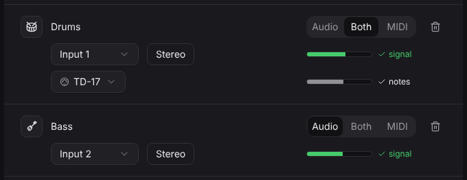

An electronic drum kit, an e-kit, sends its sound to the mixer, and every
hit down its USB cable as MIDI: which drum was hit, when and how hard, with
no sound in it. A track can record its audio, its MIDI, or both. The notes
are saved as a `.mid` beside the take's WAVs, for a DAW: the kit's sound as
it was in the room, and its hits as notes to put other drum sounds on later.
The app draws the notes in the player and never plays them.

### The switch and the port

At the top right of every track is a switch.

- **Audio** records the input, as always. Every track starts on it.
- **Both** records the input and a MIDI port, on a second line under the
  input. This is the setting for an e-kit.
- **MIDI** records a port alone, for a keyboard. The track has no input.

A MIDI port is the name a kit or keyboard has on the computer, such as
TD-17. Pick it in the list on the track's MIDI line; a MIDI cable into the
interface shows up there too. On a keyboard with two ports, the list puts
the one you play first, and during **Check signal** says “✓ notes” beside
the one that is played. Two identical devices are both listed, and the
track's line says it is not connected until you pick one. The mode and the
port stay with the musician, as the icon and **Stereo** do.

**Start rehearsal** stays off, and the screen says why, when a track on
**Both** or **MIDI** has no port yet, when two tracks take notes from one
port, and when every track is on **MIDI**: the takes are heard from their
audio. **Check signal** checks the ports too: a port's line says “no notes”
until a note has arrived, and then “✓ notes”.

### A port that is not plugged in

A port that was picked and is not there does not stop the rehearsal. Its
picker gets an amber edge, and the track says in its own line “Not
connected. Records its notes from the moment it is plugged in.” The track
waits, and its notes start when the port appears, even in the middle of a
take; the list notices a port plugged in within a couple of seconds. A port
pulled out during a take stops nothing, and if it comes back, its notes go
on in the same file.

### On the recording screen, and in the player

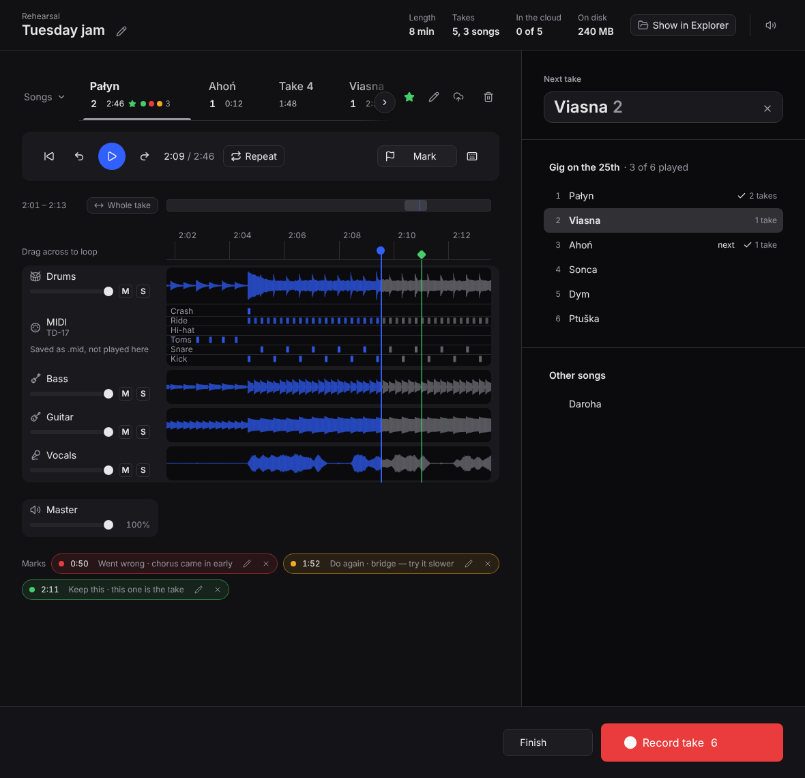

While you record, a track on **Both** has a narrow column for its notes on
the right of its tile, and a track on **MIDI** has a tile of its own. A port
that is not connected gives the tile an amber edge, and says so where the
tile is wide enough.

In the player, a track's notes are a lane of their own. On **Both** they are
the next lane under the track's audio, and share its dark background, under a
thin line; on **MIDI** they are in the track's own place among the lanes, on a
background of their own. On the left the lane says “Saved as .mid, not played
here”, and it has no **M**, **S** or fader, as there is nothing to hear. A kit
is drawn in six rows, Crash, Ride, Hi-hat, Toms, Snare and Kick; anything
else, by pitch. A track with the drums icon is drawn as a kit, and so is one
whose notes are all on MIDI channel 10. A track with no notes in a take says
“No notes in this take”. Notes that take more than a second to read show a
spinner until they are there, and notes that cannot be read say “Could not
read the notes”.

### Where the .mid files are

In the take's folder, beside the WAVs, with the same name as the track:
`Drums.wav` and `Drums.mid`. A track on **MIDI** has only a `.mid`. **Show in
Finder** (**Show in Explorer** on Windows), at the top of the window, opens
the rehearsal's folder, and the take's folder is in it. In the cloud folder,
**The original tracks** and **Both** (in **What gets sent**) copy each
`.mid` as it is; **The mix** has no notes in it.

### In a DAW

The `.mid` says its tempo in bpm, beats a minute. A take recorded with a
tempo in the metronome carries that tempo (see [The
metronome](#the-metronome)), and a take recorded without one is written at
120 bpm. Set the project to the file's tempo, or let the DAW take it, and
put the `.mid` at bar 1, where the WAVs start. Then they line up. At any
other project tempo, the notes drift from the audio.

- Logic may ask about the file's tempo, or have that question turned off.
- In Cubase, **Ignore Master Track Events on Merge** keeps the project's own
  tempo.
- Ableton Live puts every channel of a file in one clip.

A Polish or Cyrillic track name is saved as it is. Some DAWs still show it
garbled; the file's own name is right.

### Bluetooth, and Windows

Bluetooth MIDI adds a few milliseconds of uneven delay, so its notes sit a
little late and loose against the sound. For a part that has to be tight,
such as the kit, use a cable.

**Settings › Under the hood** has a **MIDI** row, under **Audio engine**,
that says which MIDI the app is using: on Windows, “Windows MIDI Services”
or “Windows MIDI”. **Copy details for a bug report** has it too. On
“Windows MIDI” a Bluetooth MIDI device cannot be seen: if yours is not in
the list, use a cable. “Windows MIDI” also lets only one program have a port
at a time. If a DAW or a drum-sound program has it, the track's line during
**Check signal** says “In use by another app. Records its notes from the
moment it is free.” While you record, the tile reads “not connected”, and
pointing at it shows *“TD-17” is in use by another app.* Close the other
program. The app holds a port too, during **Check signal** and in a
rehearsal.

## The metronome


The metronome clicks on every beat, higher on the first beat of a bar, so
you hear where each bar starts. How fast it clicks is the tempo, counted in
bpm, beats a minute. How many beats make a bar is the time signature: 4/4,
3/4, 2/4 or 6/8.

To record a take to the click, pick the song under **Next take** and check
the tempo in the metronome's row. If the row is empty, type or tap a tempo
first. Then press **Record take**. The take starts with the count-in, a bar
of clicks before the band plays, so that everyone comes in together.

In 6/8 the click comes on every eighth note, six to a bar, and the tempo
counts those eighths. A song you feel in two at 66 is 198, three times 66.
The row shows an eighth note in place of “bpm”. The first click of a bar is
the highest, and the fourth is higher than the rest, so you hear the bar's
two halves.

### The row

The metronome is one row at the bottom left of the rehearsal screen, beside
**Finish** and **Record take**. From left to right:

- The switch, the metronome's icon, turns the click in takes on or off.
  Pointing at it says “Click in takes”. It is grey when on.
- The tempo. Type a number and press Enter, or change it one at a time with
  − and +, or with ↑ and ↓ in the field. It goes from 30 to 300 bpm, and
  from 60 to 600 in 6/8. An empty field shows a dash: no tempo, and no
  click.
- The time signature, picked from a list. Changing it keeps the number: 4/4
  at 128 becomes 6/8 at 128, and you then set the number you want.
- **Tap**, to tap the tempo in (see [Tap](#tap)).
- ▶ plays the click between takes, to try a tempo or to warm up, and ■
  stops it. It also stops when you press **Record take**, since the take
  starts its own click, and when you leave the screen.
- A dot for each click of a bar, lit in time while ▶ plays. The first is
  bigger, and in 6/8 the fourth too, with the six in two groups of three.
- The gear opens the click's settings (see [The click's
  settings](#the-clicks-settings)).

The line under the row says where the tempo comes from, and what you can do
next. With the switch off it says “Off: takes record without the click.”

### A song's tempo

The metronome follows the name under **Next take**. Pick another song
there, on the screen or from the controller, and the row shows that song's
tempo and time signature.

- For a song with a tempo, the line says “The song's tempo.” You can change
  it before a take. The change holds until you pick another song, and the
  line says so: “The song has 128 · 4/4; this holds until another
  song.” **Save to song** makes the change the song's own.
- For a song with no tempo yet, such as one you played before the app had a
  metronome, the row is empty and takes record without the click. Type or
  tap a tempo. The first take you record to the click and keep gives the
  song its tempo and time signature. **Save now** gives the tempo to the
  song straight away.
- If such a song has takes, the line offers **count it from the last
  take**. The app listens to the song's last take and puts the tempo it
  counts in the row. Pick the time signature, then press **save it to the
  song**.
- For a take nobody named, the line says “Free take: no click unless you
  set a tempo.” A tempo you set stays with that take only, until you pick a
  song. If you later name the take after a song with no tempo, the song
  gets the take's tempo.

A new song, made by keeping a take under a new title, starts with the take's
tempo if the take was recorded to the click. Merging two songs keeps the
tempo of the song you merge into, or takes the other's when that one has
none.

### On a song's page

A song's page in History has its own row under the title: the tempo with −
and +, the time signature, **Tap**, ▶ and the beat's dots. A change there is
saved to the song at once. For a song with a tempo, the line under it says
“Picking Pałyn at a rehearsal puts this in the metronome.” ▶ plays the
song's tempo, and leaves the row on the rehearsal screen as it was.

For a song with no tempo, **count it from a take** lists the song's takes,
the starred ones first, then the newest. Pick a take of the whole song, then
the time signature, and press ▶ to hear the count. If the click runs twice
too fast or too slow, which happens with about one song in four, press
**halve** or **double**.

To count, the app listens to the drums: the notes of the track with the
drums icon when it records an e-kit, otherwise that track's sound, otherwise
all the tracks together. If the band sped up or slowed down, the count lands
in between.

### Tap

Press **Tap**, or the T key, on each beat. The tempo is the average of the
last four gaps between taps: five taps are enough. After two seconds
without a tap, the next one starts a new count. In 6/8, tap the eighths:
six taps to a bar. T works on the rehearsal screen and on a song's page,
but not while you are typing in a field.

After a press of **Tap** or T, the band's MIDI instruments tap too: the
drummer can tap the tempo on an e-kit's pad, or anyone on a keyboard,
through the ports the tracks record from (see [Recording
MIDI](#recording-midi)). Two seconds without a hit ends it, and what the
band plays after that leaves the tempo alone. A port another app is using
gives no taps.

### Where the click is heard

Choose where the click plays in **Settings › Click & backing track**,
under **Click output**: an interface and its outputs, chosen the same way as the playback
output (see [Choose your interface](#choose-your-interface)). Until you
choose one, **Where the player plays** is picked, and the click plays
through the playback output.

To keep the click to the drummer, pick outputs that feed only the
drummer's headphones, such as 3–4 cabled to the drummer's headphone amp, or
the laptop's own headphone socket. On many small interfaces the headphone
socket plays outputs 1–2, the same as the monitors, so a click sent there
comes out of the monitors too. A click through the speakers or the monitors
reaches the microphones and ends up on the tracks. The app itself never
records the click.

If the click's output is not connected, the line under the row says so,
with an amber icon: “The click's output, X18/XR18, is not connected. The
beat will only flash.” **Record take** still records, and the take keeps
its tempo.

On Windows, while you record through ASIO, a second ASIO interface cannot
play the click: ASIO lets the app use one interface at a time. The **Click
output** list shows such an interface greyed, with the reason under its
name.

### The click's settings

The gear at the end of the row has the same settings as **Settings ›
Click & backing track**, and a change in one shows in the other.

- **Click output**: where the click is heard, as above.
- **Volume**: how loud the click is. A bar plays when you let go of the
  slider.
- **Sound**: **Click**, **Woodblock** or **Hi-hat**. Picking one plays a bar
  of it.
- **Count-in**: **None**, **1 bar** or **2 bars**, before every take
  recorded to the click.
- **Backing track output**: where a song's backing track is heard (see
  [Where the backing track is heard](#where-the-backing-track-is-heard)).

**Settings › Click & backing track** also has the backing track's
**Volume**, **Drift shown past** (see [Where the band
drifted](#where-the-band-drifted)) and **Write the tempo into WAV files**
(see [A take's tempo in a DAW](#a-takes-tempo-in-a-daw)). The gear has
none of these three.

### Recording to the click

Press **Record take**, or Space, with the switch on and a tempo in the row.
The count-in comes first, counted in big digits where the clock will be: 1
to 4 in 4/4, the first one in blue, and 1 to 6 in 6/8, the first and fourth
in blue. With **2 bars** it counts twice. With **None** there is no
count-in, and the first click is the song's first beat. The clock starts at
0:00 when the count-in ends.

The count-in is part of the recording: the take's files start with it. In
the player, then, a take starts with its count-in and runs that much longer
than the clock showed.

After the count-in, the edge of the window lights on every click until
**Stop**, wider and brighter on the first of a bar. It does so even with
Reduce motion on in the system's settings, since the band may count on it.

The metronome's row stays at the bottom left, with the tempo, the time
signature, the dots and a line: “Count-in: 2 of 4”, then “Clicking to
Stop.” The tempo cannot change during a take. The switch turns the click
off, and on again on the beat. A take started with the switch off stays
without the click. Either way the take keeps its tempo, and the line says
“Click off. The tempo still goes into the take.” With no tempo in the row,
it says “No click: this take has no tempo.”

After **Stop**, the take records on for a moment, at most one click (two
in 6/8), so that it ends in time with the click.

### Listening back to the click

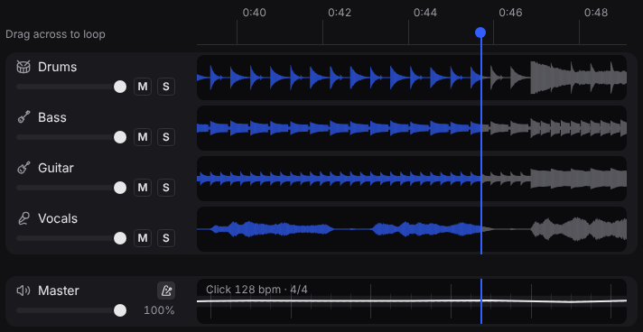

To hear the click with a take, press the button with the metronome's icon
after the name **Master**, under the tracks (see [Listening
back](#listening-back)). Pointing at it says “Click with the take: 128 bpm ·
4/4”. The click plays in time with the take's count-in.

Beside Master, the take's bars and beats are drawn as stripes, the bars
longer, with “Click 128 bpm · 4/4” in the corner. They are faint under the
band's tempo (see [Where the band drifted](#where-the-band-drifted)),
fainter still while the click is off, and follow the zoom and the selection
as the tracks do.

The click comes through the player's output, mixed with the take, at the
volume set in the click's settings. Turning **Master** down turns the click
down too. It is not in Master's meter, or in the mix sent to the cloud. The
button is off when the app starts, and stays as you left it from one take
to the next.

A take recorded without the click has no stripes, and the button is
greyed. That includes every take from before the app had a metronome. Its
row still shows the band's tempo.

### Where the band drifted


After a take, Master's row in the player shows how fast the band played,
bar by bar. The dashed line across the middle is the tempo the take was
meant to have. The grey band around it is on tempo: within 2% either way,
about 2.5 bpm at 128. The solid line is the band's own tempo, a point for
each bar.

Where the band was further off than that for two bars or more, the line
turns amber, with a number that says by how much in bpm: “+7” where it ran
ahead, “−5” where it dragged. Point anywhere along the row to see one bar:
“Bar 61 · 135 bpm (+7)”. In 6/8 the numbers count eighths, as the
metronome's do.

The words in the row's corner say what the take is measured against:

- “Click 128 bpm · 4/4”: the click it was recorded to.
- “No click · 128 bpm · 4/4”: the tempo in the metronome's row when
  **Record take** was pressed with the switch off.
- “Pałyn 128 bpm”: the song's tempo, for a take with no tempo of its own,
  such as one from before the app had a metronome.
- “No tempo · middle 126 bpm”: the take's own middle, for a take of no
  song or of a song with no tempo. Half its bars were faster than that, and
  half slower.

To find the beats, the app listens to the drums: the notes of the track
with the drums icon when it records an e-kit, otherwise that track's sound.
In a take with no drums icon, or when the drums give no beat to follow, it
listens to all the tracks together, except one with the Backing track icon,
and the words end “· from the mix”: the line is rougher then. Where the band stopped, the line breaks.

The tempo is worked out when you open a take, and a long one takes a
moment: a spinner shows in the corner until it is done. A take shorter than
four bars says “Too short to show the tempo”, and one with no beat the app
can follow says “No steady beat found”.

A song has one tempo, so a change the song is meant to have, such as a
slower bridge, shows as drift too.

To turn more or fewer bars amber, change **Drift shown past** in **Settings
› Click & backing track**: 1%, 2%, 3% or 5%.

### A take's tempo in a DAW

A take recorded to the click starts on a bar: its first click is at the
very start of every WAV and every `.mid`. To line its bars up with the bars
in a DAW:

1. Before you bring the take in, set the project to the song's tempo and
   time signature. A song in 6/8 shows half its number there, because a DAW
   counts quarter notes: 198 in the row is 99 in the DAW.
2. Put the take's files at bar 1.

A take's `.mid` files carry the tempo and the time signature, so a DAW that
reads the tempo from a `.mid` can set the project for you.

**Write the tempo into WAV files**, in **Settings › Click & backing track**,
puts the tempo and the time signature into every WAV of a take recorded to
the click, and is on until you turn it off. Cubase, Nuendo, Pro Tools and
Studio One read it and fit the take to the project's tempo, and so does FL
Studio when its own setting for that is on. At any other project tempo,
they stretch the take. Ableton Live and Logic ignore it. To have every DAW
leave your takes as they are, turn the setting off. The change applies to
the takes you record after that. A take recorded without the click never
gets a tempo in its WAVs: the band was not playing to a click, and a DAW
would stretch it for nothing.

Copies sent to the cloud as WAV (**As recorded**) keep the tempo, the mix
included. FLAC and MP3 copies do not.

## The backing track

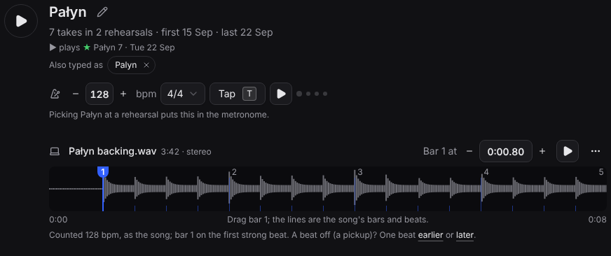

A backing track is an audio file the band plays along with: pads, keys or a
choir the band does not have, or a whole arrangement without the part
someone is learning. Each song can keep one. The app plays it from
**Record take**: it comes in on bar 1, right after the count-in, through an
output of its own, and the take keeps it as a track.

To use one, open the song's page in History and press **Add backing
track…**. Then, at the rehearsal, pick the song under **Next take** and
record as usual.

### Adding one to a song

The file can be WAV, AIFF, FLAC, MP3 or OGG, mono or stereo. M4A and AAC
files, which iTunes and Apple Music give, can't be read: export the song
from your player in one of the other formats.

The app keeps its own copy, in a `Backing tracks` folder inside the
recordings folder, so moving or deleting the file you picked changes
nothing. To use another file, press ⋯ and then **Replace…**; to take it
away, **Remove**. The old copy goes to the Trash. Takes already recorded
keep the backing track they were played with.

### Bar 1

Bar 1 is where the song's first bar starts in the file. Whatever comes
before it, such as silence or a count, is the lead-in.

When you add the file, the app counts its tempo and puts bar 1 on the first
strong beat. The line under the file says what it found, and what you can do
about it:

- A song with no tempo takes the counted one. If the click then runs twice
  too fast or too slow, press **halve** or **double**.
- A song with a tempo keeps it when the count differs. Press **take the
  backing track's tempo** to give the song the file's.
- A pickup can put bar 1 a beat off. Press **earlier** or **later** to move
  it by one beat.
- In pads with no steady beat there is nothing to count, and the line says
  so. Bar 1 stays at the file's start until you move it.

Under the file its start is drawn, with the song's bars and beats over it as
lines. To move bar 1, drag its marker, or use − and + beside **Bar 1 at**, a
hundredth of a second each. ↑ and ↓ in the field do the same, and a tenth
with Shift. Press ▶ to hear the file with the click from bar 1: the two
should land together. Every change is saved to the song at once.

### A song before its first take

To give a song a backing track before the band has played it, press **New
song** over the list of songs in History, type the title and press
**Create**. Before the first rehearsal, **New song** is in the middle of
History instead. The song's page opens. Until a take is kept under that
title, the song says “No takes yet”, and **Next take** offers it with the
other songs. A title that is a song's already says so, and **Open it** goes
to that song's page.

### On the rehearsal screen

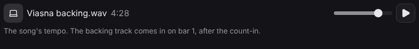

Once any song has a backing track, a second row sits under the metronome's.
From left to right:

- The switch, the backing track's icon, turns the backing track in takes on
  or off. Pointing at it says “Backing track in takes”. It is grey when on;
  off, the file is dimmed.
- The next take's file and its length.
- The volume: how loud the band hears it, one level for every song. The
  take records the file whatever the level.
- ▶ plays the file from its start, on its own, so you can hear it and set
  the volume, and ■ stops it. It also stops when you press **Record take**,
  pick another song or leave the screen.

For a song with no backing track, the row says so and where to add one. A
free take has none.

The metronome's line goes on with what the backing track will do:

- “The backing track comes in on bar 1, after the count-in.” If the lead-in
  is longer than the count-in, the part that fits plays during the count-in
  and the rest is skipped.
- “The backing track starts with Record: no click, so no count-in.” The song
  has no tempo, or the metronome is off. The take's files then start where
  the backing track starts.
- “The backing track was counted at 126: it will not follow 128.” The file
  always plays at its own speed, so a click at another tempo drifts away
  from it.
- “Backing track off: takes record without it.”
- “Getting the backing track ready…”, for a second or two after you change
  the recording quality, while the app makes the file ready to play at the
  new sample rate. A take recorded before then has no backing track.
- In amber, when its output is not connected: “The backing track's output,
  X18 5–6, is not connected. Takes record without it.”

While a take records, the row stays, and shows how far the file has got:
“1:12 / 3:42”. The switch and the volume change what the band hears, not
what the take keeps. The backing track plays on until **Stop**, silent
once the file has ended. The disk line counts it as one more track. If its
output is unplugged during the take, the file is dimmed and the line says
so in amber: “The backing track's output, X18 5–6, is not connected.”

### Where the backing track is heard

Choose its output in **Settings › Click & backing track**, under **Backing
track output**, or behind the gear in the metronome's row. Until you choose
one, **Where the player plays** is picked. Picking an output plays two
seconds of the backing track there, so you hear where it went.

Send it to the speakers the band plays to, or to the mix for in-ear
monitors, and keep the click in the drummer's headphones (see [Where the
click is heard](#where-the-click-is-heard)).

A mono file plays on both outputs of a pair. On a single output a stereo
file plays in mono. On Windows, while you record through ASIO, a second
ASIO interface cannot play it, as it cannot play the click.

The tab also has its **Volume**, the same level as the slider in the row.

### In the player

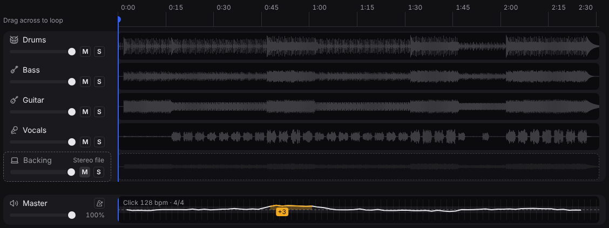

A take recorded with the backing track has one more track, **Backing**, the
last one, right above Master. The app writes it from the file, placed where
the band heard it, so in a DAW it lands on the band. Its plate and its
waveform have a dashed border, and “Stereo file” or “Mono file” follows its
name, so you can tell it from the tracks the band played.

The first time you open a take of a song, Backing is muted, so you hear the
band on its own. Turn **M** off, and every take of that song opens with the
backing track heard, until you turn **M** on again.

Its fader works as any track's. The mix sent to the cloud follows the
faders and ignores **M**, so to leave the backing track out of the mix, turn
its fader down. When the original tracks are sent, `Backing.wav` goes with
them.

## Keys

Space does the main thing on each screen: start the rehearsal, start a take,
stop recording, save the take, or play and pause while listening. The button
it presses shows the key.

While listening:

| Key | Does |
|---|---|
| ← and → | jump 10 seconds back or forward |
| Home | go back to the start |
| ↑ and ↓ | the previous or next take of the open song, at the same place |
| M | add a mark |
| R | turn Repeat on or off |
| ? | show the keys |

On the rehearsal screen, with no take open, ↑ and ↓ name the next take
after the song below or above the lit one.

On the rehearsal screen and on a song's page in History, T taps the tempo,
as **Tap** does (see [Tap](#tap)).

In History, with no take open, ↑ and ↓ go through the rehearsals, the
songs in the Songs view, or the labels in the Marks view.

Esc goes one step back. It closes a dialog first, then the strip's columns,
then the open take, then a take playing in the list of takes, then the
screen. On the rehearsal screen it finishes the rehearsal, and asks first if
there are takes in it; the start screen comes next. On the screen after a
take, it discards the take, and **Undo** brings it back. Esc never stops a
recording; press **Stop** for that.

⌘Z on a Mac, Ctrl+Z elsewhere, is **Undo** for the last thing deleted,
discarded or cropped, the last old name forgotten on a song's page, or the
last song taken out of a set, while its notice is up. See [Undo](#undo).

While you are typing in a text field, the keys type. Press Esc to leave the
field, and the keys work again.

Clicking a button or moving a fader with the mouse does not take the keys
away. Space still does the main thing, and the other keys still work. To
press a button with Space, move to it with Tab.

To turn off the keys that work with one press, open **Settings › Keys**. It
has two switches, each **On** or **Off**, and both are on until you change
them. **Space and Esc** is for Space and Esc on every screen, as above.
**The player's keys** is for the arrows, Home, M, R and ? while listening,
for ↑ and ↓ on the rehearsal screen and in History, and for T. Under each
switch is a list of what its keys do on each screen. A change applies at
once, and the app keeps it for next time.

When a switch is off, its keys do nothing and no longer show on the
buttons. With **Space and Esc** off, Space presses the button you moved to
with Tab. ⌘Z or Ctrl+Z still undoes, and Esc still closes a dialog and
leaves a text field.

## A controller

РЭХА works with one controller: the Bluetooth MIDI controller Victor Baikov
built for it ([reha-controller](https://github.com/viktor-baikov/reha-controller)).
With it, whoever is nearest can start and stop a take without going to the
laptop. Other MIDI controllers do not work this way.

To set it up, open **Settings › Controls** and pick the controller in the
**Controller** list. If it is not in the list, pair it first. On a Mac,
press **Pair Bluetooth MIDI controller** to open the Mac's own Bluetooth
MIDI window, pair it there, and come back. On Windows, pair it in the
Bluetooth settings of Windows. When the line under the list says
“Controller ready”, it works.

From the controller:

- **Record/Stop** starts a take. Pressed again, it stops the take and keeps
  it. The laptop's **Stop** is different: it opens the screen where you save
  or discard the take.
- With the metronome's click on, **Record/Stop** counts the band in as
  **Record take** does on the laptop, at the tempo in the metronome's row
  (see [Recording to the click](#recording-to-the-click)). The controller's
  display shows 00:00 until the count-in ends, then counts the take's time
  from there, as the clock on the laptop's screen does.
- **Play/Stop** plays a kept take, or stops it.
- You can also go back to the start of the take, skip back or forward,
  move to the previous or next song or take, set the volume, and start and
  finish the rehearsal. Moving to another song puts that song's tempo in
  the metronome, as picking it on the laptop does.
- Removing a take from the controller works like deleting it in the app:
  a notice says “Take removed”, and its **Undo** brings the take back.

What the controller sends is never recorded into a track's notes. If the
controller drops out during a take, the take keeps recording.

## Undo

Deleting a take or a rehearsal, clearing false starts, discarding a take
and cropping one happen at once, without a question first. A notice in the
corner says what went, for example *“Pałyn 5” went to the Trash.*, with an
**Undo** button. For 10 seconds, **Undo** or ⌘Z on a Mac (Ctrl+Z
elsewhere) puts it back where it was: a take with its star, marks and cloud
copy, a rehearsal with all its takes, a cropped take as it was before the
crop, a discarded take on the screen after it with the name and marks it
had. Holding the mouse over the notice keeps it up.

Forgetting a song's old name on its page in History works the same way: the
notice says *“Palyn” was forgotten.*, and **Undo** gives the name back to
its song. See [Names and songs](#names-and-songs).

So does taking a song out of a set in **Settings › Sets**: the notice says
*“Pałyn” was taken out of the set.*, and **Undo** puts the song back where
it was. See [Play by a set](#play-by-a-set).

⌘Z brings back the newest one first; an older notice keeps its own
**Undo**. While you type in a field, ⌘Z is the field's own, and it does
nothing while a dialog is open or a take is recording. A notice also goes
when what it would bring back is removed again: a take cropped a second
time keeps only the second crop's **Undo**, and a deleted rehearsal takes
the notices of its takes with it. Switching the recordings folder ends
them all.

When the notice goes, what went moves on to the Trash, or the `_deleted`
folder on a computer without one, where you can still get it back by hand.
Starting the next take, or finishing the rehearsal, ends the notice for a
discarded take. Saving or discarding a take ends the notice for a crop made
on the screen after it. If the app closes before the notice goes, what went
moves to the Trash then.

## When something goes wrong

### The interface will not open, or sends no sound

Checking the signal or starting a take can fail with a message that ends in
`[PaErrorCode -9999]`. It means the driver refused without saying why, and it
happens almost only with ASIO on Windows. Or the interface opens but the bars
do not move, and after a few seconds the app says there is no sound from it.

The most common reason is that an ASIO interface can only be used by one
program at a time. Close any other program that might be using it: a DAW,
the interface's own mixer or control app, or a second copy of РЭХА. Then
try again.

If that does not help, the app can test the interface for you. Open
**Settings › Under the hood** and press **Check the interface**.

Play or talk into the inputs while it listens. If sound arrives, it says so
and lights up the inputs that had signal. That takes about five seconds. If no
sound arrives, it tries several more times, changing one setting each time,
and then tells you what is wrong and what to do. An interface that opens but
sends nothing can take up to a minute to test; **Stop** ends it early.

If it says that the driver only works with its outputs opened too, or that
the interface opens but sends no sound, record through WASAPI for now:
choose **Windows WASAPI** as the driver in **Settings › Audio**. The same
interface is listed there too, usually with fewer inputs. The Realtek
ASIO driver that comes with some laptops is known to behave like this.

To ask for help, press **Copy details for a bug report** on the same page and
paste what it copies into your message. It says which version you have, what
the computer is, which interface and settings you record with, which MIDI
the app is on, what the last check found, and where the app keeps its files.
The **Show** buttons there open the folder with the settings, the history or
the crash log, if someone asks you to send one.

The same test also runs from a terminal, in the folder where you unpacked
the app. From there it can test another interface too: add its number, from
the list it prints, after the command.

```
Reha.exe --audio-probe
```

### The interface goes away during a take

If the interface is unplugged or switched off during a take, the take stops
on its own after three seconds without sound. Everything recorded until then
is kept, and the take opens as usual, with a note saying why it stopped. Plug
the interface back in and record the next take. If it is not offered, press
**Look again** in Settings. A MIDI port that goes away does not stop a take:
see [A port that is not plugged in](#a-port-that-is-not-plugged-in).

When a take, the signal check or playback has just started, the interface
gets five seconds to send its first sound, because some drivers take a
moment to start.

The signal check stops in the same way, and playback pauses. Press play once
the interface is back. If it is still gone, the take plays through the
computer's own output.

Sometimes a driver does not recover after its interface disappears. The take
is still saved, after about fifteen seconds, and until the driver responds
again the app says “The audio driver has stopped answering”. Unplug the
interface and plug it back in. If that does not help, restart the app.

### The laptop goes to sleep during a take

The app keeps the laptop awake while a take records, but closing the lid,
choosing Sleep, or a battery about to run out still put it to sleep: no app
can stop that. The take then ends where the laptop went to sleep. Everything
recorded until then is kept, and nothing from after waking is added to it.
Once the laptop is awake, the take opens as usual, with a note saying why it
stopped: “The laptop went to sleep at 21:14, so the take ends there.
Everything up to that moment is saved.” Record the next take as usual.

### The app closed during a take

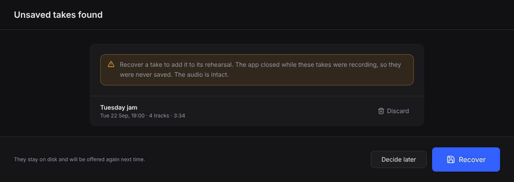

The app writes every track to disk while you play, and makes sure it is
saved every 30 seconds. If the app closes or crashes during a take, you lose
at most the last half minute. The notes of a MIDI track are written the same
way, and come back with the take. If you close the window during a take, the
take stops and is offered the next time you open the app.

Next time you open the app, it offers these takes first, under the title
*Unsaved takes found*. Press **Recover** at the bottom right to add the
take to its rehearsal. With more than one take, the button says
**Recover all** and adds the takes one after another, and each take has its
own **Recover** too. If one fails, **Recover all** stops there and a notice
says why. The takes before it are in their rehearsals. The one that failed
and the ones after it stay in the list. Takes are recovered one at a time,
so while one is being recovered, every **Recover** is greyed. That keeps
each take's number in its rehearsal right.

**Discard** moves a take to the Trash at once (**Undo** brings it back).
**Decide later** keeps the takes for next time. If a take is being recovered
when you press it, that take is recovered first, and the rest are kept. Each
take's row is titled with its rehearsal's name. Under the name are the day
and time the rehearsal began, the number of tracks and the length, so you
can tell two takes of one rehearsal apart by their length. A long name is
cut after two lines. Point at it to read it whole.

## Where the files are

Recordings are kept in the RehearsalRecordings folder in your home folder,
for example `C:\Users\alex\RehearsalRecordings` on Windows. You can choose
another folder in **Settings › Folders**. **Settings › Under the hood**
shows the exact paths.

```
RehearsalRecordings/
  library.sqlite                     the history: rehearsals, takes, marks
  Tuesday jam - 2026-09-18 19-00/
    _drafts/
      take 3/                        the take being recorded right now
        Drums.wav
        Vocals.wav
    01 - Verse riff/                 saved take 1
    02 - Verse riff 2/               saved take 2
```

While a take records, it is written to `_drafts`. **Save take** moves it into
its own folder, and **Discard** moves it to the Trash.

A track that records MIDI leaves a `.mid` beside the WAVs, with the same
name. See [Where the .mid files are](#where-the-mid-files-are).

A song's backing track is copied into a `Backing tracks` folder inside the
recordings folder. A take recorded with it has a `Backing.wav` beside the
band's tracks. See [The backing track](#the-backing-track).

Deleted takes and rehearsals go to the Trash or the Recycle Bin. On a
computer without one, they go to a `_deleted` folder inside the recordings
folder. Until their notice goes, they wait in a `_deleting` folder inside
the recordings folder, so that **Undo** can put them back.

Rehearsals with no saved takes are removed on their own. A folder that still
holds an unsaved take, or any other file, is left alone.

Keep the recordings folder on the computer's own disk. Do not put it in a
folder that Google Drive or Dropbox syncs, and do not put it on a network
drive. The history file changes while the app runs, and a sync app can
damage it. To share takes, use the cloud folder instead.

To move the recordings folder to another disk or computer, close the app
first, then move the whole folder.

If you go back to an older version of the app after this one has opened the
recordings folder, the older version may show an empty history, or refuse to
open the folder. Your recordings are not affected.

## Marks and their labels

A mark's label is a name and a colour: *Note*, *Keep this*, *Went wrong*
and *Do again* to start with. In **Settings › Marks** you can make your own
(*Solo*, *Tempo*, *Lyrics*, whatever the band marks), rename them, give them
another colour from the palette of eight, drag them into another order and
delete them.

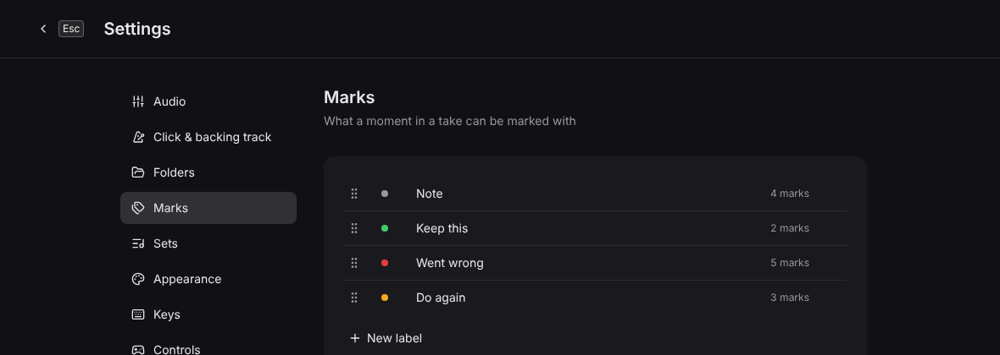

- The order is the order of the labels in the switch when you mark a
  moment, and a new mark gets the first label.
- Renaming or recolouring a label changes every mark that has it, in every
  rehearsal.
- Each label says how many marks have it. One with none is deleted at once.
  For one in use, the app asks which label its marks get instead.
- The last label cannot be deleted: every mark needs one.
- Under a take, every mark is listed, by its label's name and then its
  comment, if it has one.

A label does nothing else: it changes how its marks look, what they are
called, and under which label History's **Marks** view lists them.

## Appearance

In **Settings › Appearance**, choose the **Theme**: **Dark**, **Light** or
**Match system**, which follows the computer's own setting. **Scale** makes
everything on screen bigger or smaller, from 90% to 150%.

At a large scale in a small window, the sections down the left of Settings
(Audio, Folders and the rest) show as icons only, so the section you have
open gets the room their names took. Point at an icon to see its name. This
happens when the window is narrower than 900 px at 100%, or 1350 px at
150%.

## A new version

When a newer version is out, a dot appears on the gear on the start screen,
and another on **Under the hood** in Settings. There, the group named
**Updates** says which one is out, and **What's new** opens its page on
GitHub. The dots stay until you run the new version. When there is nothing
newer, the same place says “This is the latest version.” once GitHub has
answered, and “Not checked yet.” until then.

To update:

1. Press **Update**. The app downloads the new version, unpacks it beside
   this copy and checks that it starts. The line shows how far it has got.
2. When the line says the new version is ready, press **Restart now**. The
   app closes, the new version takes its place, and it opens again a few
   seconds later. A notice in the corner says which version it is now.

You can go on working before you press **Restart now**. If you close the
app instead, the new version waits, and **Restart now** is there the next
time you open it.

The old copy stays beside the new one, named with its version, for example
“Reha 0.14.0”, until the new one has opened. Then it goes to the Trash (the
Recycle Bin on Windows). Your recordings, the history and the settings are
kept in other folders, so an update does not touch them. On Windows a
version the app downloads itself carries no “from the internet” flag, so
there is nothing to unblock.

**On a Mac, macOS asks for the microphone again after each update.** The
app is not signed with a paid developer certificate, so macOS treats each
version as a new app. The new version opens the microphone for a moment
right after the restart, so the question comes then, and not at the first
take with the band waiting. Allow it, as you did the first time.

If something goes wrong, this copy stays as it was:

- If getting the new version ready fails, the line says why, and **Try
  again** starts again.
- If the new version cannot be put in place, for example because another
  program held one of the app's files, the old copy opens again. If the app
  took too long to close, nothing opens: open it yourself. Either way a
  notice says so, the line in **Updates** says why, and **Try again** there
  restarts again.

### When the line says the copy can't replace itself

Instead of **Update**, the line can say “This copy can't replace itself
where it is.” The app cannot write to the folder it runs from. On a Mac this
happens when you open the app straight from where it was unpacked, in
Downloads for example: macOS then runs it from a hidden read-only copy. Move
it to Applications in Finder and open it from there. On Windows it happens
in a folder such as Program Files: move the app's folder to Documents in
Explorer and open it from there. Then **Update** appears.

Until then, **Download** fetches the new version into your Downloads folder,
checks that it is the release's own and that nothing in it is damaged, and
opens the folder with it picked out. Unpack it, close the app and open the
new copy. If the download is cut short or damaged, nothing is left behind
and **Try again** fetches it again. A download that is already there and
whole is not fetched twice.

### Asking GitHub

To find out, the app asks GitHub which version is the latest when it starts,
and once a day while it stays open. It sends nothing else, it downloads a
new version only when you press **Update** or **Download**, and it never
asks while a take is recording.
With no internet in the room it does not find out. To stop the asking,
untick **Check for new versions** in **Settings › Under the hood**.
